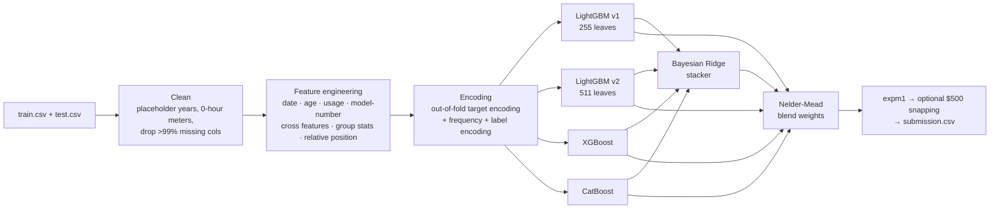

# Heavy Equipment Selling Price Prediction


Predicting the auction sale price of used heavy machinery (loaders, excavators, graders, …) from
**49 noisy, partly missing, high-cardinality features**, using classical machine learning only.

Built for the **IIT Madras BS — Machine Learning Practice (MLP) Project, May 2026 term**, run as a
Kaggle competition: *Heavy Equipment Selling Price Prediction Challenge*.

| | |
|---|---|
| **Final leaderboard score** | **RMSLE 0.18741** |
| **Final rank** | **85 / 2,593 teams (top 3.3 %)** |
| 5-fold CV RMSLE (blend) | 0.1938 |
| Features engineered | 49 raw columns → 270 model features |
| Models | 2 × LightGBM, XGBoost, CatBoost → Bayesian Ridge stack → optimised blend |

---

## Problem

Each row is one finalised sale of a machine: when and where it was sold, when it was built, how many
hours it has run, its model string (`950FII`, `PC200LC6`, …), product configuration and ~30 anonymised
mechanical-spec columns (`col1` … `col30`). The task is to predict `TargetValue`, the sale price in USD.

- **Metric:** Root Mean Squared Logarithmic Error, `sqrt(mean((log1p(pred) − log1p(actual))²))`.
- **Data:** 138,701 training rows, 15,000 test rows, 50 columns (see [`docs/data_dictionary.md`](docs/data_dictionary.md)).
- **Constraints:** classical ML only — NumPy, pandas, scikit-learn, XGBoost, LightGBM, CatBoost, SciPy,
  statsmodels, plotting libraries. No deep learning, no AutoML, no Optuna; all work done in a Kaggle notebook.

## Approach



1. **Model log-price.** Training on `log1p(price)` with an RMSE objective optimises RMSLE directly and
   tames the right-skewed price distribution.
2. **Clean the obvious noise.** Manufacture years of `1000`/`1001` are placeholders → NaN + missing flag;
   an hour-meter reading of `0` means "not recorded" → NaN + flag; columns >99 % empty are dropped.
3. **Engineer ~220 new features**
   - *Time:* sale year/month/quarter/day-of-year, days since the first sale.
   - *Depreciation:* equipment age (+ log, sqrt, square, buckets, new/old flags).
   - *Usage:* hours, hours per year of age, hours × age interactions.
   - *Model string:* the first number in `Spec_FullDescriptor` (e.g. `950`), a proxy for machine size.
   - *Cross features:* configuration × age bucket, configuration × sale year, region × category, …
   - *Group statistics:* mean/median/std of hours and age, and group size, per configuration, class,
     category, region.
   - *Relative position:* a unit's hours/age/date percentile and deviation *within its configuration*.
4. **Encode categoricals without leakage.** Every categorical (including high-cardinality IDs) gets a
   frequency encoding and a **5-fold out-of-fold, smoothed target encoding**, then a label code.
5. **Ensemble.** Four gradient-boosting models trained with 5-fold CV and early stopping; their
   out-of-fold predictions feed a Bayesian Ridge stacker; final weights over all five are found with
   Nelder–Mead on OOF RMSLE.

Details and design rationale: [`docs/methodology.md`](docs/methodology.md).

## Results

| Model | 5-fold OOF RMSLE |
|---|---|
| LightGBM v1 (255 leaves, lr 0.008) | 0.1944 |
| LightGBM v2 (511 leaves, lr 0.006) | 0.1947 |
| XGBoost (depth 7) | 0.1977 |
| CatBoost (depth 8) | 0.1992 |
| Bayesian Ridge stack | 0.1938 |
| **Final blend** (LGB1 .068 · LGB2 .073 · XGB .016 · CAT .020 · Stack .822) | **0.1938** |

**Leaderboard:** 0.18741 RMSLE, rank 85 of 2,593 teams. Across 20 notebook submissions the score went
from 0.669 (version 5) → 0.194 (version 7) → 0.187 (version 23, final).
Full submission history: [`docs/results.md`](docs/results.md).

## Repository structure

```
heavy-equipment-price-prediction/
├── src/heavy_equipment/        # the pipeline as an importable package
│   ├── config.py               #   paths, column groups, all model hyper-parameters
│   ├── data.py                 #   loading + train/test stacking, log-target
│   ├── features.py             #   target-free feature engineering
│   ├── encoding.py             #   imputation, out-of-fold target encoding, label encoding
│   ├── models.py               #   K-fold training for LightGBM / XGBoost / CatBoost
│   ├── ensemble.py             #   Bayesian Ridge stacking, blend weights, price snapping
│   ├── metrics.py              #   RMSE / RMSLE
│   └── pipeline.py             #   end-to-end run → submission + metrics.json
├── scripts/
│   ├── train.py                # CLI entry point
│   ├── eda.py                  # summary tables + figures → reports/
│   ├── download_data.sh        # fetch the competition data with the Kaggle CLI
│   └── make_synthetic_data.py  # schema-identical fake data for tests / demos
├── notebooks/
│   └── 01_competition_notebook_v23.ipynb   # the original Kaggle notebook (scored 0.18741)
├── docs/                       # data dictionary, methodology, results
├── tests/                      # pytest suite (runs on synthetic data)
├── data/raw/                   # put train.csv / test.csv here (not committed)
├── outputs/                    # submission.csv, oof_predictions.csv, metrics.json
├── requirements.txt · pyproject.toml · Makefile
```

## Quickstart

```bash
git clone https://github.com/<your-username>/heavy-equipment-price-prediction.git
cd heavy-equipment-price-prediction
python -m venv .venv && source .venv/bin/activate
pip install -r requirements.txt

# 1) try the whole pipeline in ~20 s on synthetic data (no Kaggle account needed)
make demo

# 2) run the tests
make test
```

### Reproducing the competition submission

The dataset belongs to a private course competition and is not redistributed here. With access:

```bash
bash scripts/download_data.sh          # or copy train.csv / test.csv into data/raw/
python scripts/eda.py                  # optional: tables + figures in reports/
python scripts/train.py                # full run: 4 models × 5 folds (several CPU hours)
python scripts/train.py --models lgb1 lgb2 --estimator-scale 0.3   # faster variant
```

Outputs land in `outputs/`: `submission.csv`, `oof_predictions.csv` and `metrics.json`
(per-fold scores, best iterations, blend weights). The package reproduces the notebook's feature
matrix column-for-column (checked against the notebook code), and uses the same hyper-parameters,
folds and seeds.

## Key takeaways

- **Optimise the metric you are scored on.** RMSLE on price = RMSE on `log1p(price)`, so every model is
  trained and early-stopped directly on the competition metric.
- **Domain-shaped features.** Depreciation (age at sale), usage intensity (hours per year) and a
  machine's position relative to identical configurations encode how equipment is actually priced.
- **Target encoding must be out-of-fold**, otherwise high-cardinality IDs like `AssetID` leak the
  target and CV becomes meaningless.
- **Stacking gives a small but consistent gain** over the best single model (0.1944 → 0.1938 OOF),
  with every fold improving.

## Acknowledgements

Competition hosted by IIT Madras BS (Data Science & Applications) on Kaggle as the MLP course project.
Dataset © the competition host; this repository contains only my code.

## License

Code released under the [MIT License](LICENSE). The competition data is not included.
